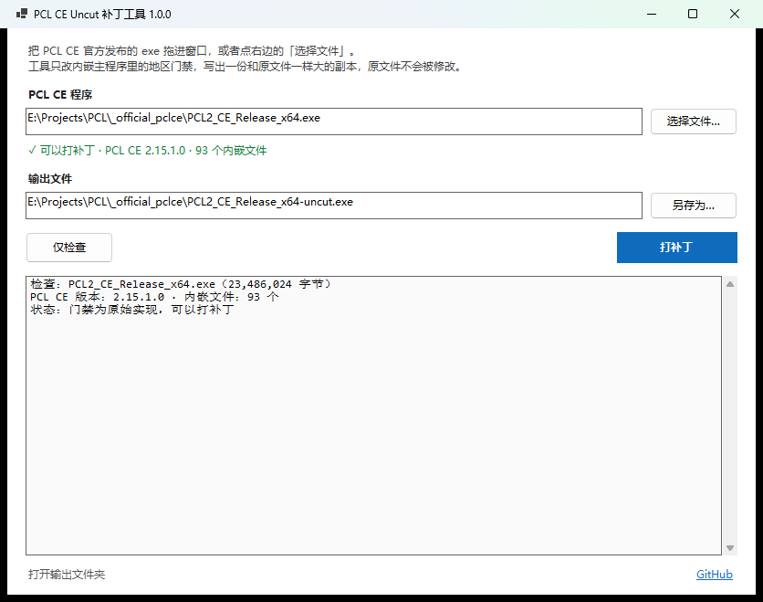

# PCL-CE-Uncut-Patcher

> 一个用于 **恢复官方 PCL CE 构建中被删减功能** 的补丁工具。

它直接修改官方发布的 `PCL2_CE_Release_*.exe`，把「中国大陆地区禁用 Minecraft 下载与安装」这道门禁改成恒不生效。**不重新编译、不改源码、不修改你选中的原文件**，输出一份和原文件长度完全相同的副本。



<br/>

## 支持的文件

| 文件 | 平台 | 处理方式 |
|---|---|---|
| `PCL2_CE_Release_x64.exe` | Windows x64 | 改写内嵌 `Plain Craft Launcher 2.dll` 里的门禁方法体 |
| `PCL2_CE_Release_ARM64.exe` | Windows ARM64 | 同上 |

工具是 Windows 程序（.NET 10 + WinForms），**发布包已自带运行时**，不需要另外装 .NET。

<br/>

## 下载

到 [Releases](../../releases/latest) 下载 `PCL-CE-Uncut-Patcher.exe`（约 52 MB，自包含单文件）。

<br/>

## 用法

### 图形界面

双击打开，把 exe 拖进窗口（或者点「选择文件…」）→ 点「打补丁」。

- 选中文件后自动检查，直接显示 PCL CE 版本和能否打补丁
- 输出默认放在原文件旁边，文件名加 `-uncut`；也可以「另存为…」
- 「仅检查」只验证这个文件能不能打补丁，不写出任何东西
- 完成后弹窗显示大小与 SHA-256，可以直接打开所在文件夹

### 命令行

```text
PCL-CE-Uncut-Patcher.exe PCL2_CE_Release_x64.exe
PCL-CE-Uncut-Patcher.exe PCL2_CE_Release_x64.exe -o D:\out\PCL2_CE_uncut.exe
PCL-CE-Uncut-Patcher.exe PCL2_CE_Release_x64.exe --check
PCL-CE-Uncut-Patcher.exe --gui D:\下载\PCL2_CE_Release_x64.exe
```

**带参数是命令行，不带参数是图形界面**，同一份程序，同一套逻辑。

<br/>

## 被删减了什么

PCL CE 在 2026-10-20 的提交 `8cd9d374`（*fix(install): 中国大陆地区禁用 Minecraft 安装功能 (#3673)*）里加了地区门禁，同一天的 `v2.15.1` 就带着它发布。

判定逻辑在 `PCL.Core/App/Region/RegionPolicy.cs`，只要满足任意一条就算「中国大陆」：

- 系统区域名是 `CN` 或数字 `156`
- 注册表 `SOFTWARE\Microsoft\Windows\CurrentVersion\Control Panel\DeviceRegion` 的 `DeviceRegion` 为 `45`（GeoID）
- 时区是 `China Standard Time` / `Asia/Shanghai` / `PRC`，且系统区域或界面语言是 `zh-CN`

另外 `RegionAssessment.IsRestricted => Mainland or Unknown`——**拿不到区域信息也算受限**，是一个 fail-closed 的写法，所以关掉定位、改语言也不一定能绕开。

所有拦截点最后都汇总在 `Plain Craft Launcher 2/Modules/Minecraft/RestrictedFeaturePolicy.cs` 的三个成员上，一共 12 处调用：

| 位置 | 被拦的功能 |
|---|---|
| `ModDownloadLib.cs:71` | `minecraft-client-download` 原版客户端下载 |
| `ModDownloadLib.cs:138` | `minecraft-client-save` 保存下载的客户端 |
| `ModDownloadLib.cs:536` | `minecraft-client-save` 另存为 |
| `ModDownloadLib.cs:3741` | `minecraft-install` 安装 |
| `ModDownloadLib.cs:3798` | `ThrowIfRestricted("minecraft-install")` |
| `PageDownloadInstall.xaml.cs:2330` | `minecraft-install` 下载页安装 |
| `PageInstanceInstall.xaml.cs:101` | `minecraft-loader-install` 安装 Forge / NeoForge / Fabric 等 |
| `PageInstanceOverall.xaml.cs:578` | `minecraft-repair` 补全文件 |
| `PageInstanceOverall.xaml.cs:645` | `minecraft-reset` 重置版本 |
| `ModModpack.cs:25`、`:59` | `modpack-install` 整合包安装 |
| `PageDownloadCompDetail.xaml.cs:65` | `online-modpack-install` 在线整合包 |
| `PageLaunchLeft.xaml.cs:97` | `auto-modpack-install` 启动时自动装整合包 |
| `ModLaunch.cs:340`、`:343` | 启动前跳过缺失文件下载 / `minecraft-launch-missing-files` 提示 |

界面上对应的两条文案是：

- `Region.Feature.Restricted`：Minecraft 下载、补全与整合包安装功能在你所在的国家或地区不可用。
- `Region.Feature.Unknown`：无法获取区域信息，暂时无法使用 Minecraft 下载、补全与整合包安装功能。

<br/>

## 补了什么

只动 `PCL.RestrictedFeaturePolicy`，把它改成恒放行：

```csharp
namespace PCL;

internal static class RestrictedFeaturePolicy
{
    internal static bool IsRestricted => false;
    internal static bool Check(string feature, bool showHint = true) => true;
    internal static void ThrowIfRestricted(string feature) { }
}
```

`RegionPolicy` 本身原样保留（判定代码还在，只是没人再因为它拦人了），第 12 处调用 `IsRestricted` 的启动流程也会当成「不受限」继续走。

<br/>

## 怎么做的

PCL CE 的 Release 是 .NET 单文件包（single-file bundle）：前面是 PE 引导程序，中间按顺序排放内嵌文件，文件末尾是条目表，每条 `offset(8) size(8) compressedSize(8) type(1) nameLen(1) name`，整张表正好结束在文件末尾。

工具的做法：

1. 从文件末尾往前 4 MB 扫描，找一条能一路解析到 EOF 的条目链，确认是单文件包；
2. 取出 `Plain Craft Launcher 2.dll`（官方发布是未压缩存放的，直接切片）；
3. 用 Mono.Cecil 读出三个方法的 RVA，再用自写的 PE 节表把 RVA 换算成文件偏移；
4. 原地改写方法体为 `tiny 头 + IL`（`ldc.i4.0; ret`、`ldc.i4.1; ret`、`ret`）；
5. 写回后再整体解析一遍，确认包结构没坏、三个方法确实改成了预期形态，才落盘。

**不重建 bundle**，所以文件长度一个字节都不变，条目表、各条目偏移、引导程序全部原样。改动只有三个方法体开头的几个字节，x64 和 ARM64 都只有 8 个字节不同（见下）。

安全性上，工具不认「看起来像」的文件：找不到条目链、找不到主程序 dll、门禁方法的实现和预期不一致，都会直接报错停下；已经打过补丁的文件会被识别出来并拒绝重复处理。

<br/>

## 已验证（官方 v2.15.1）

| 目标 | 原始大小 | 补丁后大小 | 差异字节 | 补丁后 SHA-256 |
|---|---|---|---|---|
| `PCL2_CE_Release_x64.exe` | 23,486,024 | 23,486,024 | 8 | `0d0e0d23b2039bba51960da74064feb32d61de414441eeb1f4ddce382bf73234` |
| `PCL2_CE_Release_ARM64.exe` | 23,133,776 | 23,133,776 | 8 | `4edec33454a0c1f9569c508d41e0fce7436c11bb304dd7251520e95cb2cee4bd` |

- 与官方文件逐字节对比：x64 的 8 个差异全部落在 `0x000A72A5`–`0x000A7314`，也就是内嵌主程序 dll 的区间里，区间外 0 字节变化
- 用 `ilspycmd` 反编译补丁后的 dll：`IsRestricted => false`、`Check => true`、`ThrowIfRestricted` 空实现
- 把内嵌的托管 dll 抽出来，用测试宿主反射调用三个方法：`Check=True IsRestricted=False ThrowIfRestricted=ok`
- 对补丁后的文件再跑 `--check`：拒绝（退出码 1），提示「这个文件已经打过补丁了」
- 拿 `notepad.exe` 去试：拒绝（退出码 1），提示「找不到内嵌的 .NET 单文件包结构」

<br/>

## 限制和注意事项

- 只处理**未压缩**的内嵌包。官方 Release 就是未压缩的；哪天上游开了压缩，工具会明确报错而不是改坏文件。
- **不处理自动更新**。PCL CE 检查到新版本后会把自己更新成官方版，补丁随之消失，需要重新打一遍。
- 补丁会改动内嵌主程序，官方随 Release 提供的 Sigstore 签名（`.sigstore.json`）自然对不上，这是改二进制的必然结果。
- 本仓库是非官方产物，与 PCL 原作者、PCL CE 社区维护者都没有关系。

<br/>

## 和 PCL-CE-Uncut 的关系

| 仓库 | 做法 | 适合 |
|---|---|---|
| [PCL-CE-Uncut](https://github.com/snake-aabb-wtf/PCL-CE-Uncut) | 克隆源码、改一个文件、CI 重新编译 | 想看源码、想自己改、想自己构建 |
| **PCL-CE-Uncut-Patcher**（本仓库） | 直接给官方 exe 打补丁 | 想用官方构建、只想解除限制 |

两个仓库做的事情一样：让 v2.15.1 里被砍掉的 Minecraft 下载、补全、整合包安装重新可用。

<br/>

## 构建

```bash
dotnet publish PCL-CE-Uncut-Patcher.csproj -c Release -r win-x64 \
  --self-contained true -p:PublishSingleFile=true \
  -p:EnableCompressionInSingleFile=true -o dist
```

需要 .NET 10 SDK。CI 会在 Ubuntu 上发布、在 Windows 上下载官方两个架构的 exe 做端到端验证（补丁后长度不变、差异字节数、重复补丁被拒、非 PCL CE 文件被拒）。

<br/>

## 许可

GPL-3.0。PCL、PCL CE 的代码和发布产物版权归各自作者所有，本仓库只包含补丁工具本身的代码。
